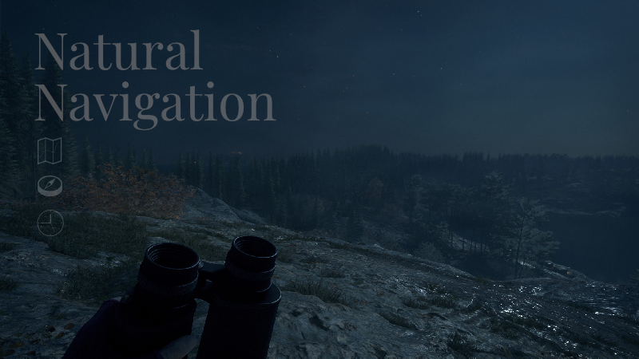

# gz-navigation

> A generation zero mod for navigating the map with no markers   

Written in C++ and based on [gz-console-thingy](./gz-console-thingy.md).



## Modes

**Location Guesser:**
1. Player is transported to a specific location
2. They have to mark and confirm it on the map
3. A score is calculated based on the distance from the actual position

**Extraction:**
1. Player is transported to a specific location
2. They have to get to another specific location (based on textual descriptions / images / markers on the map / tv adverts / phone calls / phone voice mails)
3. A score is calculated based on the time

Variations with time limits

## How to use this mod?

1. Download mod from releases

2. Move `gz_nav/` to the same folder as `GenerationZero_F.exe`

3. Run `gz_nav/install.bat` to install the mod

4. Edit `gz_nav/settings.ini` to change the game mode

5. *(Optional) run `gz_nav/uninstall.bat` to uninstall the mod*

## Development

### Setup

Install requirements:
* C++17 compatible compiler (Visual Studio 2017 or later recommended)
* CMake 3.16 or later

Clone repo recursively because of git submodule dependencies
```bash
git clone --recurse-submodules https://github.com/frinckz/gz-location.git
```

### Build

Configure cmake project by opening CMakeLists.txt with your IDE or running the following in an "x64 Native Tools Command Prompt for VS" (or after calling `vcvars64.bat`)
```bash
cmake -S . -B cmake-build-debug -G Ninja -DCMAKE_BUILD_TYPE=Debug
```
Use `-B cmake-build-release -DCMAKE_BUILD_TYPE=Release` for a release build. Source files are collected with a glob, so run the configure command again after adding or moving files.

Build `xinput9_1_0` with your IDE or running
```bash
cmake --build cmake-build-debug --target xinput9_1_0
```
*The DLL is written to `cmake-build-debug/out/Debug/` and copied to `C:/Program Files (x86)/Steam/steamapps/common/GenerationZero/` after the build (adjust the path in `CMakeLists.txt` for other install locations). 
Close the game first, otherwise the copy fails because the DLL is in use.*
Copy `gz_nav/` to the same folder as `GenerationZero_F.exe`.


### Regenerate addresses

Regenerate `src/addresses.h` and `src/addresses.cpp` after a game update
```bash
cmake --build cmake-build-debug --target address-generator
cmake-build-debug/out/Debug/address-generator.exe
```

### Dependencies

All dependencies live in `deps/`.

| Dependency | Type | Used for |
|------------|------|----------|
| [Dear ImGui](https://github.com/ocornut/imgui) | git submodule (`deps/imgui`) | The in-game UI (console window, settings and tabs under `src/imgui/`), rendered through its Win32 and DirectX 11 backends |
| [MinHook](https://github.com/TsudaKageyu/minhook) | git submodule (`deps/minhook`) | Installing function hooks (detours) into the game, e.g. for the patches in `src/patches.cpp` |
| [meow-hook](https://github.com/xforce/meow-hook) | git submodule (`deps/meow-hook`) | `func_call` (header-only) to call game functions by address in the mod; the pattern scanner (compiled library) is used by `address-generator` to find those addresses |
| [FW1FontWrapper](https://github.com/FW1/FW1FontWrapper) | in-repo (`deps/fw1`) | DirectWrite text rendering on the game's DirectX 11 context, used for on-screen hint text |

The `address-generator` target scans the game executables for byte patterns and writes `src/addresses.h` and `src/addresses.cpp`. It needs the Steam build and, optionally, the Microsoft Store build installed. If one is missing, its previous addresses are kept.

## Credits

* [gz-console-thingy](https://github.com/j4ceee/gz-console-thingy) by jacee (j4ceee), MIT, itself based on jc4-console-thingy by Aaron Kirkham; memory research by aSwedishMagyar, sanitka and pigeon (Cheat Engine tables)
* [DECA](https://github.com/kk49/deca) by kk49
* [REA](https://github.com/morluto/rea) by morluto
